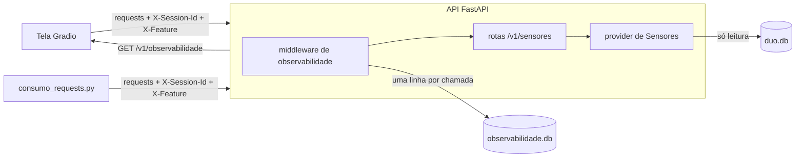
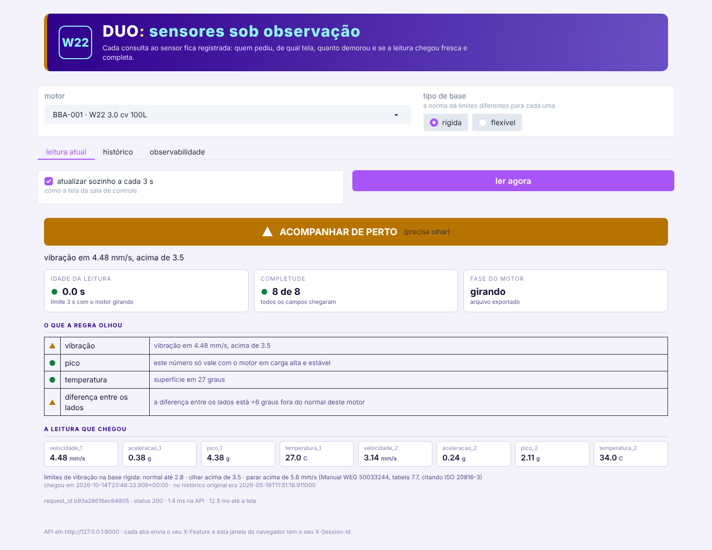
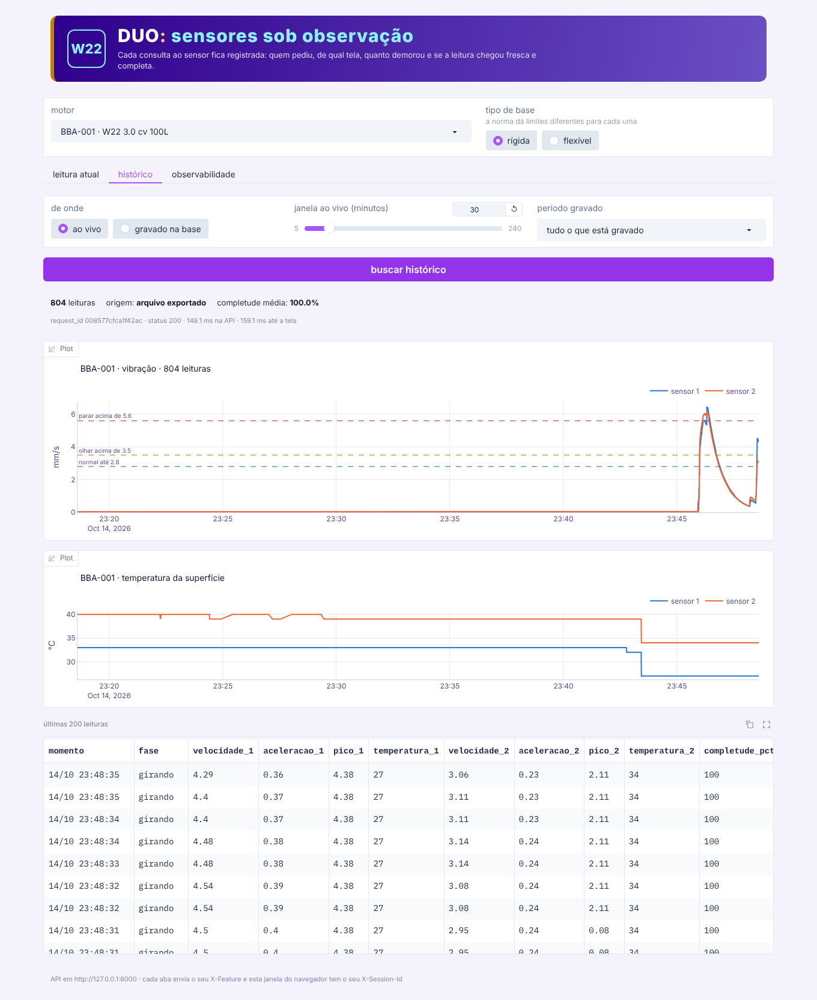
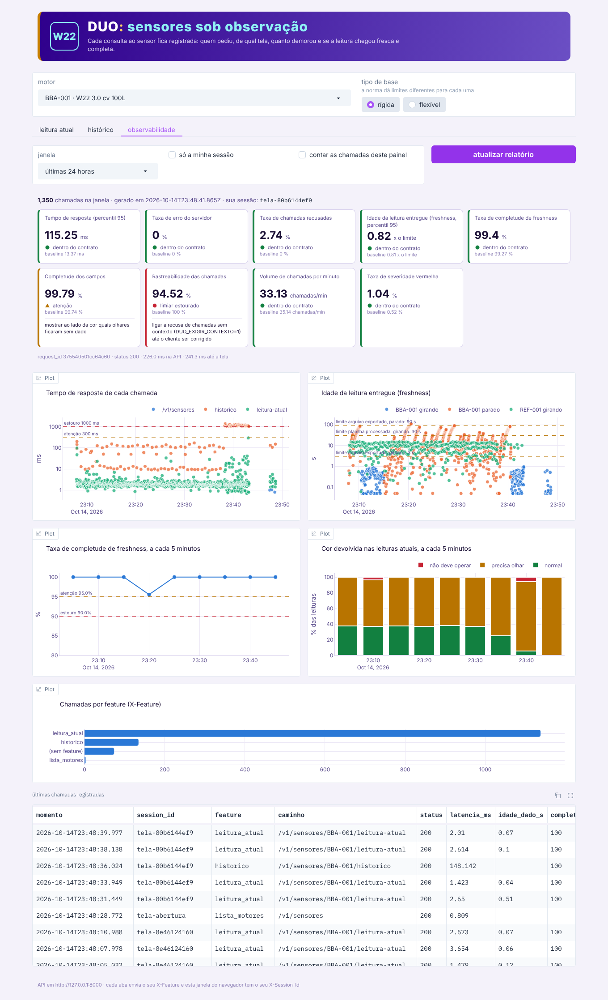

# Sensor Monitoring API

Checkpoint integrado das disciplinas de **Governança em IA** e **Front-end**.

Neste checkpoint, o grupo analisou uma parte específica do DUO, o gêmeo digital em desenvolvimento para o motor WEG W22 da Forzy, com o objetivo de observá-la em profundidade. A parte definida pelos professores foi o provedor de Sensores, responsável pela leitura atual e pelo histórico das medições. Para isso, esse provedor foi disponibilizado como uma API em FastAPI, na qual cada chamada gera um registro de observabilidade. Além disso, foi desenvolvida uma interface em Gradio que consome os endpoints da API por meio da biblioteca requests.

## Integrantes

| Nome |
|---|
| Mayara Mota |
| Gabriel Palmeira |

## O que tem aqui

```
duo-sensor-monitoring/
├── backend/
│   ├── main.py                  API FastAPI e o middleware que registra cada chamada
│   ├── provider_sensores.py     leitura atual, histórico e severidade (vem da Sprint 4)
│   ├── observabilidade.py       grava os registros e calcula os indicadores
│   └── contrato_metricas.json   o contrato: indicadores, baselines, limiares e ações
├── frontend/
│   ├── cliente_api.py           todas as chamadas passam por aqui, com os headers
│   ├── consumo_requests.py      script de consumo dos três endpoints
│   ├── app_gradio.py            a tela, com uma aba para cada endpoint
│   └── relatorio_observabilidade.py   gera as figuras para o documento de Governança
├── dados/
│   ├── duo.db                   base histórica do DUO (Sprint 4), aberta só para leitura
│   ├── BBA-001.json             ficha do motor
│   └── tabelas/                 tabelas de referência (norma, sensor, isolamento...)
├── docs/
│   ├── relatorio/               figuras e números das medições (baseline e problemas)
│   ├── telas/                   prints das três abas
│   └── Governanca_Observabilidade_DUO_ABNT.docx
└── requirements.txt
```

## Como as partes conversam



1. A tela e o script usam o mesmo `cliente_api.py`, e é ele que coloca os headers `X-Session-Id` e `X-Feature` em toda chamada. Cada janela da tela ganha a sua sessão, e cada aba manda a sua feature (`leitura_atual`, `historico`, `painel_observabilidade`).
2. O middleware da API marca a hora em que a chamada chegou, deixa a rota trabalhar e, na saída, grava uma linha com os headers, o status, a latência e o que a rota sabe sobre o dado entregue: a idade da leitura, a fase do motor, a completude e a cor.
3. A resposta volta com `X-Request-Id` e `X-Latencia-ms`, de modo que a tela mostra o identificador de cada chamada e dá para achar o registro dela depois.

### De onde vem a leitura "ao vivo"

A bancada não tem sensor ligado agora. Por isso, a API reproduz o histórico real de 19/05/2026 (7.183 leituras dos dois sensores VIM32PL do BBA-001) no mesmo ritmo em que ele chegou na fábrica, inclusive com as pausas de quando o motor estava parado. É o mesmo papel da `FonteSimulador` da Sprint 4. O REF-001 reproduz o conjunto de referência de 12 horas, e o BBA-002 aparece sem sensor, de propósito, para mostrar a resposta cinza.

A severidade usa os quatro olhares da norma que já existiam na Sprint 4 (vibração pela ISO 20816-3, pico, temperatura pela classe de isolamento e diferença entre os lados). Os dois olhares que dependem dos modelos treinados ficaram de fora desta API, porque os arquivos `.pkl` pesariam o projeto sem mudar o que está sendo observado.

## Endpoints

| Funcionalidade | Rota | O que devolve |
|---|---|---|
| Leitura atual | `GET /v1/sensores/{tag}/leitura-atual?base=rigida` | leitura, cor, motivo, idade da leitura, completude |
| Histórico | `GET /v1/sensores/{tag}/historico?minutos=30&fonte=ao_vivo` | leituras da janela ao vivo, ou `fonte=gravado&de=...&ate=...` para o que está na base |
| Observabilidade | `GET /v1/observabilidade?minutos=60` | indicadores comparados com o contrato e os registros de cada chamada |
| Contrato | `GET /v1/observabilidade/contrato` | o contrato de métricas completo |
| Motores | `GET /v1/sensores` | os motores cadastrados |

A documentação interativa fica em `http://127.0.0.1:8000/docs` com a API ligada.

## O que cada chamada registra

`request_id`, `momento` (UTC), `session_id`, `feature`, `headers_completos`, `metodo`, `rota`, `caminho`, `tag`, `status`, `latencia_ms`, `idade_dado_s`, `limite_freshness_s`, `dentro_freshness`, `fase`, `origem`, `completude_pct`, `severidade`, `quantidade_leituras`, `cliente` e `erro`. A explicação de cada campo está no próprio `contrato_metricas.json`.

## Como rodar na sua máquina

Precisa de Python 3.10 ou mais novo.

```bash
git clone <link do repositório>
cd duo-sensor-monitoring
python -m venv .venv
# Windows: .venv\Scripts\activate    Linux e Mac: source .venv/bin/activate
pip install -r requirements.txt
```

Depois, abra dois terminais na pasta do projeto, com o ambiente ativado.

**Terminal 1, a API:**
```bash
uvicorn backend.main:app --port 8000
```

**Terminal 2, a tela:**
```bash
python -m frontend.app_gradio
```
A tela abre em `http://127.0.0.1:7860`.

**Script de consumo** (com a API ligada):
```bash
python -m frontend.consumo_requests              # chama os três endpoints uma vez
python -m frontend.consumo_requests --simular 30 # 30 min de uso normal, três sessões
python -m frontend.consumo_requests --problemas 5  # 5 min de uso com problemas
```

**Figuras para o documento** (datas em UTC):
```bash
python -m frontend.relatorio_observabilidade --nome baseline --de 2026-10-14T23:08:00 --ate 2026-10-14T23:38:00
```

### Ajustes por variável de ambiente

| Variável | Para que serve | Padrão |
|---|---|---|
| `DUO_API_URL` | endereço da API usado pela tela e pelo script | `http://127.0.0.1:8000` |
| `DUO_VELOCIDADE` | acelera a reprodução do histórico (2 = duas vezes mais rápido) | `1` |
| `DUO_INICIO_S` | começa a reprodução em outro ponto do histórico, em segundos | `0` |
| `DUO_EXIGIR_CONTEXTO` | com `1`, a API recusa chamada sem `X-Session-Id` e `X-Feature` | `0` |
| `DUO_BANCO_OBSERVABILIDADE` | onde gravar os registros | `dados/observabilidade.db` |
| `DUO_PORTA_TELA` | porta da tela Gradio | `7860` |

## O que medimos

Rodamos 30 minutos de uso normal (`--simular 30`) e depois 5 minutos de problemas (`--problemas 5`). As figuras e os números de cada período estão em `docs/relatorio/`, e o contrato já traz as baselines medidas.

| Indicador | Baseline (uso normal) | Atenção | Estouro |
|---|---|---|---|
| Tempo de resposta p95 | 13,4 ms (leitura atual 2,8 ms; histórico 144 ms) | 300 ms | 1 s |
| Taxa de erro do servidor | 0% | 0,5% | 2% |
| Freshness p95 | 0,81 vez o limite | acima do limite | 5 vezes o limite |
| Taxa de completude de freshness | 99,3% | abaixo de 95% | abaixo de 90% |
| Completude dos campos | 99,7% (agosto chega com 75%) | abaixo de 100% | abaixo de 75% |
| Rastreabilidade | 100% | abaixo de 100% | abaixo de 95% |
| Volume | 35,1 chamadas por minuto | 3 vezes a baseline | 10 vezes a baseline |
| Severidade vermelha | 0,5% | 15 pontos de distância | 30 pontos de distância |

Três coisas que só apareceram porque cada chamada ficou registrada:

1. **O limite de freshness com o motor parado precisou mudar.** Começamos com 60 s, porque 99% dos intervalos entre leituras ficavam abaixo de 44 s. Mesmo assim, 9% das leituras atuais chegaram atrasadas: a tela pergunta em qualquer momento do relógio, e as pausas longas ocupam muito mais tempo do que a contagem de intervalos mostra. Medindo pelo tempo, o limite foi para 90 s na versão 1.1 do contrato.
2. **A coleta de agosto pelo endereço da Forzy chega com 75% dos campos**, porque não traz os dois canais de pico. Com isso, o olhar do fator de crista fica sem dado.
3. **A regra de severidade deixa o BBA-001 amarelo mesmo parado**, porque compara a diferença de temperatura entre os lados de maio (cerca de 6 °C) com a referência aprendida em agosto (1 °C).

## Telas

| Leitura atual | Histórico | Observabilidade |
|---|---|---|
|  |  |  |

## Documento de Governança

O documento no padrão ABNT, com o contrato de métricas, os limiares, a camada gráfica, o plano de ação e os resultados, está em `docs/Governanca_Observabilidade_DUO_ABNT.docx`.

## O que ficou fora, como os professores pediram

Autenticação e autorização ficam para a Sprint 4 final, assim como a migração dos providers de Equipamentos e Plantas.

## Vídeo

Link do vídeo de demonstração: *(colocar aqui)*
